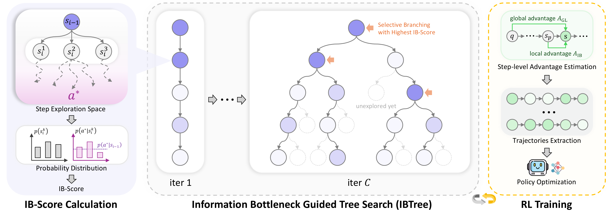
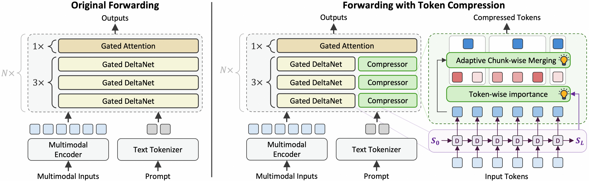

<h2 align="center">EfficientRL</h2>

<p align="center">
  Official repository for a collection of research papers from the <b>ATH MaaS Team</b> at <b>Alibaba</b>.
</p>
<p align="center">
  
</p>


---

### 📚 Papers

| Paper | Venue | Resources |
| :--- | :---: | :---: |
| **[IBTPO](#ibtpo)**<br/><sub>Long Live The Balance: Information Bottleneck Driven Tree-based Policy Optimization</sub> | [](#ibtpo) | [](https://arxiv.org/abs/2605.28109) [](./IBTPO) |
| **[V-CoLA](#v-cola)**<br/><sub>V-CoLA: Vision Token Compression with Linear Attention</sub> | [](#v-cola) | [](https://arxiv.org/abs/2610.11251) [](./V-CoLA) |

---

<a id="ibtpo"></a>
### 🔥 IBTPO: Information Bottleneck Driven Tree-based Policy Optimization

<p align="center">
  <a href="https://arxiv.org/abs/2605.28109">arXiv</a> &bull;
  <a href="https://arxiv.org/pdf/2605.28109">Paper</a> &bull;
  <a href="#citation">Citation</a>
</p>

Official implementation of <em>"Long Live The Balance: Information Bottleneck Driven Tree-based Policy Optimization"</em>, accepted at <b>ICML 2026</b> main conference.

<p align="center">
  
</p>

**Code:** [`IBTPO/`](./IBTPO)

---

<a id="v-cola"></a>
### 🔥 V-CoLA: Vision Token Compression with Linear Attention

<p align="center">
  <a href="https://arxiv.org/abs/2610.11251">arXiv</a> &bull;
  <a href="https://arxiv.org/pdf/2610.11251">Paper</a> &bull;
  <a href="#citation">Citation</a>
</p>

Official implementation of <em>"V-CoLA: Vision Token Compression with Linear Attention"</em>, accepted at <b>EMNLP 2026</b>.

<p align="center">
  
</p>

**Code:** [`V-CoLA/`](./V-CoLA)

---

<a id="citation"></a>
### Citation

If you find our work useful, please consider citing the corresponding paper(s). Click to expand the BibTeX entries:

<details>
<summary><b>🔥 IBTPO</b> (ICML 2026)</summary>

```bibtex
@article{jiang2026info,
  title={Long Live The Balance: Information Bottleneck Driven Tree-based Policy Optimization},
  author={Jiang, Hao and Li, Shurui and Bu, Tianpeng and Xu, Bowen and Liu, Xin and Chen, Qihua and Duan, Hongtao and Hu, Lulu and Yang, Bin and Zhang, Minying},
  journal={arXiv preprint arXiv:2605.28109},
  year={2026}
}
```

</details>

<details>
<summary><b>🔥 V-CoLA</b> (EMNLP 2026)</summary>

```bibtex
@article{jiang2026v,
  title={V-CoLA: Vision Token Compression with Linear Attention},
  author={Jiang, Hao and Mao, Yiru and Bu, Tianpeng and Zhou, Hao and Duan, Hongtao and Jing, Wang and Xu, Bowen and Chen, Xin and Hu, Lulu and Yang, Bin and others},
  journal={arXiv preprint arXiv:2610.11251},
  year={2026}
}
```

</details>
